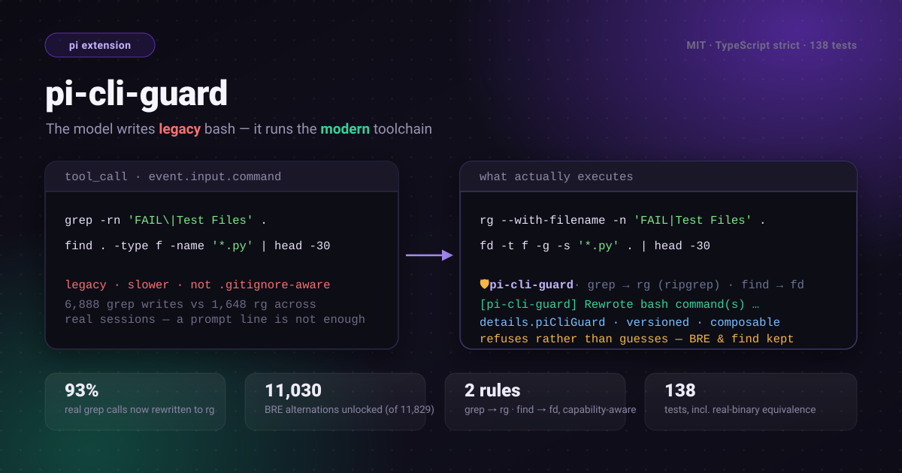

# pi-cli-guard

[English](../README.md) | 简体中文

<p align="center">
  
</p>

[](../LICENSE)
[](https://www.npmjs.com/package/pi-cli-guard)
[](https://github.com/tychenjiajun/pi-cli-guard/releases/latest)
[](https://pi.dev/docs/latest/extensions)
[](https://pi.dev/docs/latest/packages)
[](../tsconfig.json)
[](../package.json)
[](https://github.com/tychenjiajun/pi-cli-guard/actions/workflows/ci.yml)
[](https://www.npmjs.com/package/pi-cli-guard)
[](https://pnpm.io)

> **一句话：** *pi-cli-guard 把模型写的遗留 bash 改写成 harness 本就自带的现代
> 工具链——`grep` → `rg`，以及一个保守的 `find` → `fd`——改写发生在 `tool_call`
> 这个接缝上，因此它与其他 bash 扩展组合，而不是覆盖工具。*

**pi-cli-guard** 是一个开源（MIT）、TypeScript 编写的
[pi](https://github.com/earendil-works/pi) AI 编码代理扩展，它把代理的 bash 命令
规范化到首选的现代工具链：

- **`grep`/`egrep`/`fgrep` → `rg`**（[ripgrep](https://github.com/BurntSushi/ripgrep)）
- **`find` → `fd`**（[fd](https://github.com/sharkdp/fd)）——仅限一个保守的白名单子集

它**不**覆盖 `bash` 工具。它在 `tool_call` 事件里改写 `event.input.command`，因此
与其他 bash 扩展（尤其是
[`pi-tool-guard`](https://github.com/tychenjiajun/pi-tool-guard)）组合，而不是与之冲突。

> 为什么存在：pi 的系统提示词已经推荐 `rg`，但真实会话显示模型依然频繁使用遗留
> 工具。跨三个仓库实测：**6,888 次 `grep` bash 调用 vs 1,648 次 `rg`**，以及
> **899 次 `find` vs 1 次 `fd`**——外加用户反复打断说*“grep 太慢了，用 rg”*。
> 一行提示词不够，harness 必须动手修。

## 安装

```bash
pi install npm:pi-cli-guard
# 或者为单个会话加载这个 checkout：
pi -e .
```

`rg` 与 `fd` 必须在 `PATH` 上。当目标二进制缺失时该规则会被跳过，因此原始命令绝不
会被改写成一条会失败的命令。（Debian/Ubuntu 上 `fd` 叫 `fdfind`；两者都能识别。）

## 配置

从环境变量读取——无需任何 settings 管道：

| 变量 | 默认 | 含义 |
|---|---|---|
| `PI_CLI_GUARD` | on | `off`/`0`/`false` 完全禁用扩展 |
| `PI_CLI_GUARD_RULES` | all | 逗号列表：短名（`rg`、`egrep`、`fgrep`、`fd`）或完整 id（`grep-to-rg`、`find-to-fd`） |
| `PI_CLI_GUARD_NOTICE` | on | `off` 不再往结果里追加改写说明 |

## 它改写什么

### `grep` → `rg`

`egrep` 与 `fgrep` 共用这个翻译器：它们就是隐含 `-E`/`-F` 的 `grep`，当注入的
标志与 rg 的默认方言一致时会被丢弃。

两个工具的单字母选项含义相撞，因此简单改名并不安全。这些冲突被显式映射：

| grep | rg | 原因 |
|---|---|---|
| `-r` | `--with-filename` | `grep -r` 总会打印文件名；rg 对单个文件不会 |
| `-R` | `-L --with-filename` | rg 没有 `-R`；它的 `-L` 是跟随符号链接 |
| `-h` | `--no-filename` | rg 的 `-h` 是*帮助* |
| `-H` | `--with-filename` | rg 的 `-H` 是*隐藏文件* |
| `-s` | `--no-messages` | rg 的 `-s` 是*大小写敏感* |
| `-L` | `--files-without-match` | rg 的 `-L` 是跟随符号链接 |
| `-E` | *(丢弃)* | grep 的 ERE ≈ rg 的默认正则 |
| `-I` | *(丢弃)* | rg 默认忽略二进制文件 |
| `--include=G` | `-g G` | |
| `--exclude=G` | `-g '!G'` | |
| `--exclude-dir=D` | `-g '!D/**'` | |

其他常见项（`-i -v -w -x -c -l -n -o -q -a -F -P -A/-B/-C -e -f -m`、`--color`……）
原样通过。

**方言闸门。** grep 的默认方言是 BRE；rg 使用 Rust regex，其中 `a+` 表示一个及以上
的 `a`，而不是字面量 `a+`。只有当 BRE 模式在两种方言下可证明等价时才会被改写：纯
字面量、安全转义（如 `\.`）、以及 BRE 交替——它会被改写为 `a\|b` → `a|b`（这是真实
世界里最常见的模式——`grep "FAIL\|Test Files"`）。其他任何情况（未转义的
`+ ? ( ) { }`、`\+`、`\s`、方括号表达式内的 `\|`、带 shell 展开的模式……）都会
**拒绝**并保持原命令不动。`-E`、`-F`、`-P` 方言兼容，始终允许。

### `find` → `fd`

只有以下形式会被翻译，其余一律拒绝：

| find | fd |
|---|---|
| `find [path] -name GLOB` | `fd -g -s GLOB [path]`（显式 `-s` 压过 fd 的智能大小写） |
| `-iname GLOB` | `-g -i GLOB` |
| `-type f/d/l` | `-t f/d/l` |
| `-maxdepth N` / `-mindepth N` | `-d N` / `--min-depth N` |
| `-name A -o -name B` | `-g '{A,B}'` |
| `-path GLOB`（以 `*` 开头） | `-p -s REGEX`（glob → 全路径 regex） |
| `-path GLOB -name GLOB` | `-p -s REGEX --and '(^\|/)BASENAME$'` |
| 内部无 `-o` 的 `\( … \)` | *（括号被丢弃）* |
| 前置 `-L` | `-L`（跟随符号链接） |

`-path` 的 glob 会变成 `*` 仍可跨 `/` 的 Rust regex；只有以 `*` 开头的 glob
会被接受，因为正是这一点让 find 的全路径匹配与 fd 无锚定的 `--full-path` 匹配
彼此一致。

拒绝（保持 `find`）：`-exec`、`-delete`、`-prune`、`-newer`、`-perm`、
`-size`、`-regex`、`!`/`-not`、不属于 name glob 之间的布尔 `-o`、隐式 AND
的多个 name glob、含 `/` 的 name glob、带锚定的 `-path` glob、`-path` 与
`-iname` 或 `-o` 链的组合、内部含 `-o` 的分组（真实优先级），以及 `-o` 名字链
与 `-type` 的组合（find 的 AND 优先级高于 `-o`，因此
`-type f -name a -o -name b` 无法用一次 fd 调用表达）。

## 保真保证与已知偏差

引擎用 [`unbash`](https://github.com/webpro-nl/unbash) 解析命令，只对
“命令名…参数”这段区间做拼接替换，因此该区间之外的重定向、管道、`&&`/`||` 链、环境
变量前缀和注释都逐字节保留。含命令替换/进程替换，或参数区间内插有重定向的命令会
被整体跳过。引擎是幂等的。

已接受、已记录的偏差（会通过说明告知模型）：

- **rg 遵循 `.gitignore` 并跳过隐藏文件**；`grep -r` 不会。这正是速度收益所在；
  `-u`/`--no-ignore` 可恢复全量搜索。
- **fd 跳过隐藏与 `.gitignore` 的路径**，目录会带结尾 `/` 打印，且不列出搜索根自身。
- **`grep PATTERN DIR` 不带 `-r`** 在 grep 里报错，在 rg 里会递归搜索——这把一个常见
  的模型失误变成了可用的行为。
- **会改变含义的 BRE 模式**拒绝而非猜测。

规则识别到但拒绝翻译的命令会逐字节保持原样，只在 `refusals` 里报告，这样模型能
区分“没有忠实的等价写法”和“根本没检查过”。

改写会回报给模型（bash 结果尾部的说明），并记录在 `details.piCliGuard` 里：

```ts
import { readPiCliGuardDetails } from "pi-cli-guard/contract";

const guard = readPiCliGuardDetails(result.details);
if (guard) {
  guard.originalCommand; // "grep -rn foo ."
  guard.command;         // "rg --with-filename -n foo ."
  guard.changes;         // [{ rule: "grep-to-rg", before, after }]
  guard.refusals;        // [{ rule: "find-to-fd", before, reason }] —— 被拒绝的改写
}
```

## 与 `pi-tool-guard` 的组合

pi 的工具注册表是*同名首次注册者胜*。`pi-tool-guard` 已经覆盖了 `bash`，因此第二次
`registerTool("bash")` 会静默地禁用它。所以本扩展从不注册工具；它在 `tool_call` 事件
里改写输入。`pi-tool-guard` 看到的是改写后的命令，仍可剥离/重放尾部的 `rg`/`fd`
视图抽取器。

## 相关 pi 扩展

- [pi-tool-guard](https://github.com/tychenjiajun/pi-tool-guard) —— 让昂贵的 bash
  命令只跑一次、留住完整日志，并修复写错的工具调用参数。`pi-cli-guard` 正是为了与
  它的 `bash` 覆盖组合而写。
- [pi-codemode-guard](https://github.com/tychenjiajun/pi-codemode-guard) —— 在 LLM
  编写的 codemode 脚本进入沙箱前先编译。
- [pi-codemode-snippets](https://github.com/tychenjiajun/pi-codemode-snippets) ——
  把 `// @snippet:` 的 `.js` 文件变成一个有名字、可组合的 pi 工具。
- [pi-skill-guard](https://github.com/tychenjiajun/pi-skill-guard) —— 守护 skill 的
  加载与调用。
- [pi-voice](https://github.com/tychenjiajun/pi-voice) —— pi 的语音输入。

## 开发

```bash
pnpm install
pnpm test        # 169 个单元 + 真实二进制等价测试
pnpm typecheck
pi -e .          # 为单个会话加载这个 checkout 作为扩展
```

等价测试会用真实的 `rg`/`fd` 分别运行*原始*命令与*改写后*命令并比较 stdout；
二进制缺失时会跳过。

设计说明见 [`AGENTS.md`](../AGENTS.md) 与 [`CONTEXT.md`](../CONTEXT.md)。
pi 官方文档：
[Extensions](https://pi.dev/docs/latest/extensions) ·
[Pi packages](https://pi.dev/docs/latest/packages)。

## License

MIT